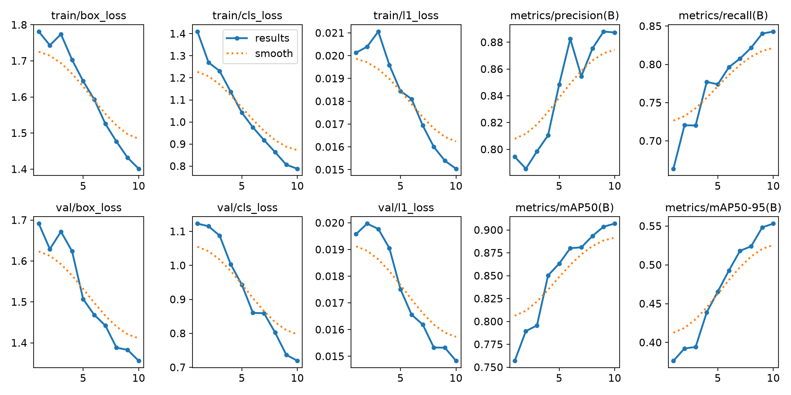
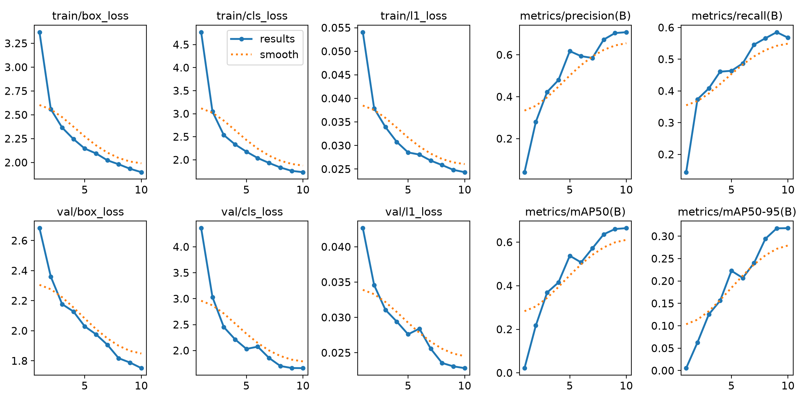
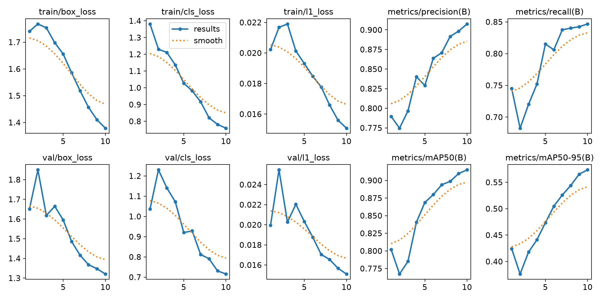
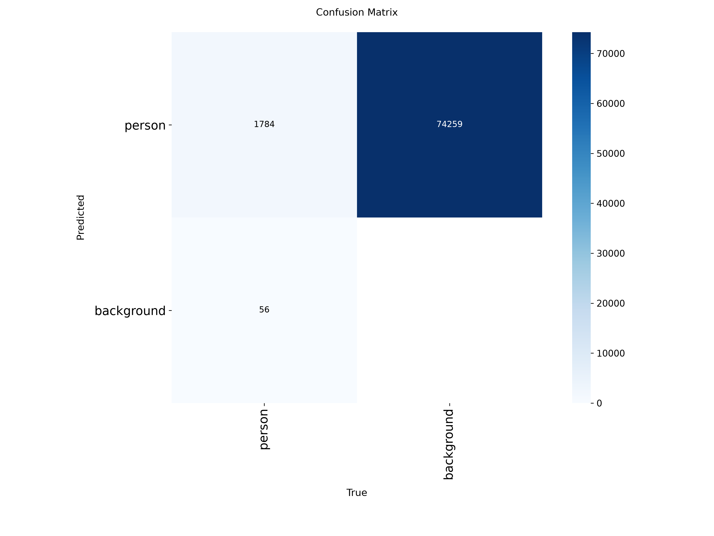
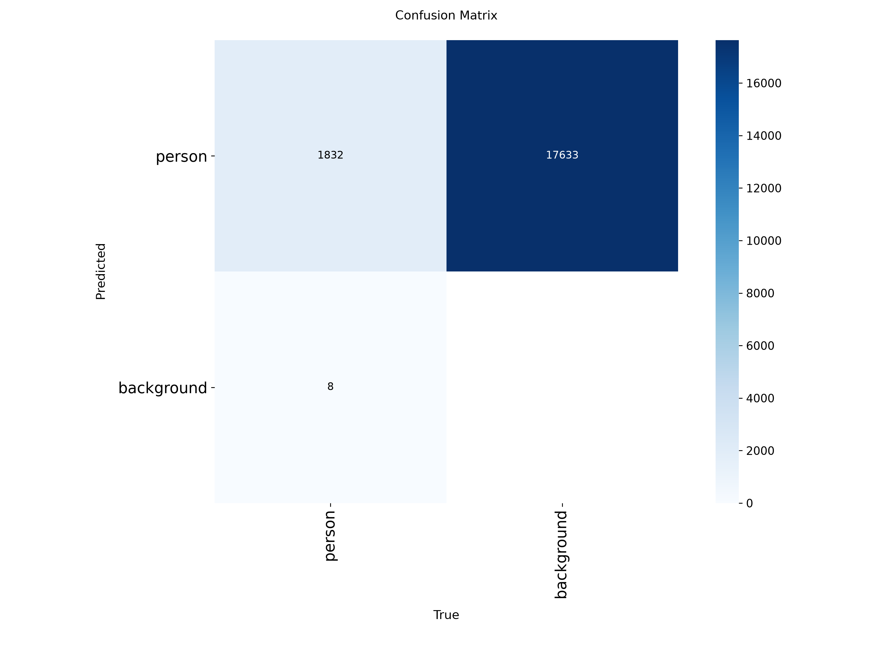
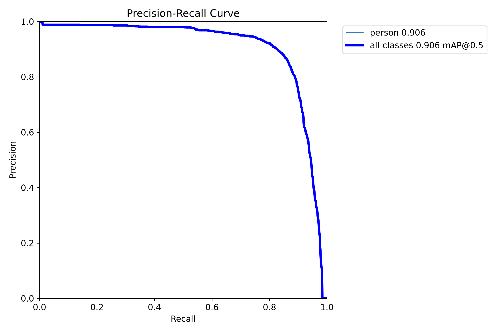
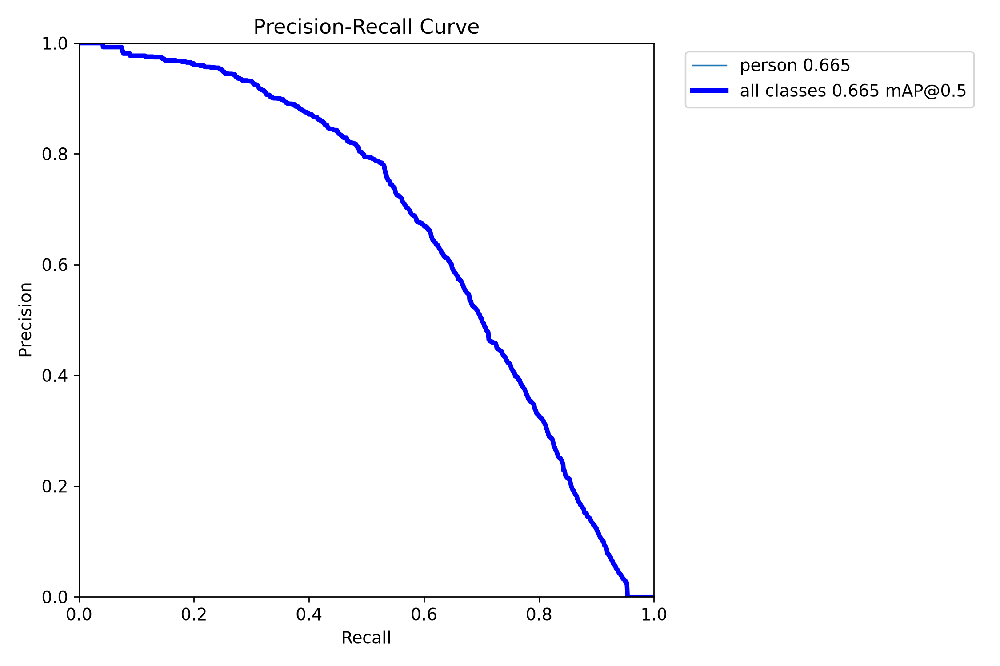
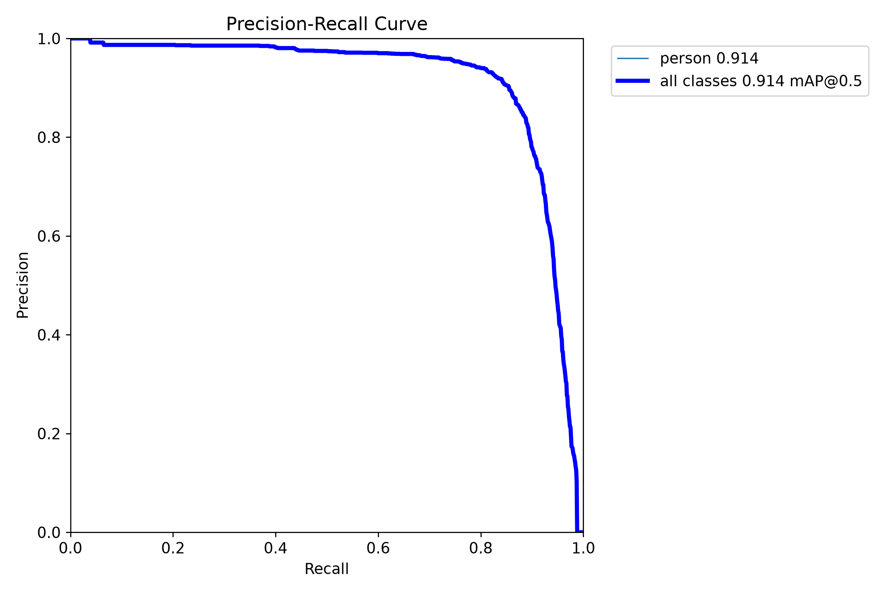
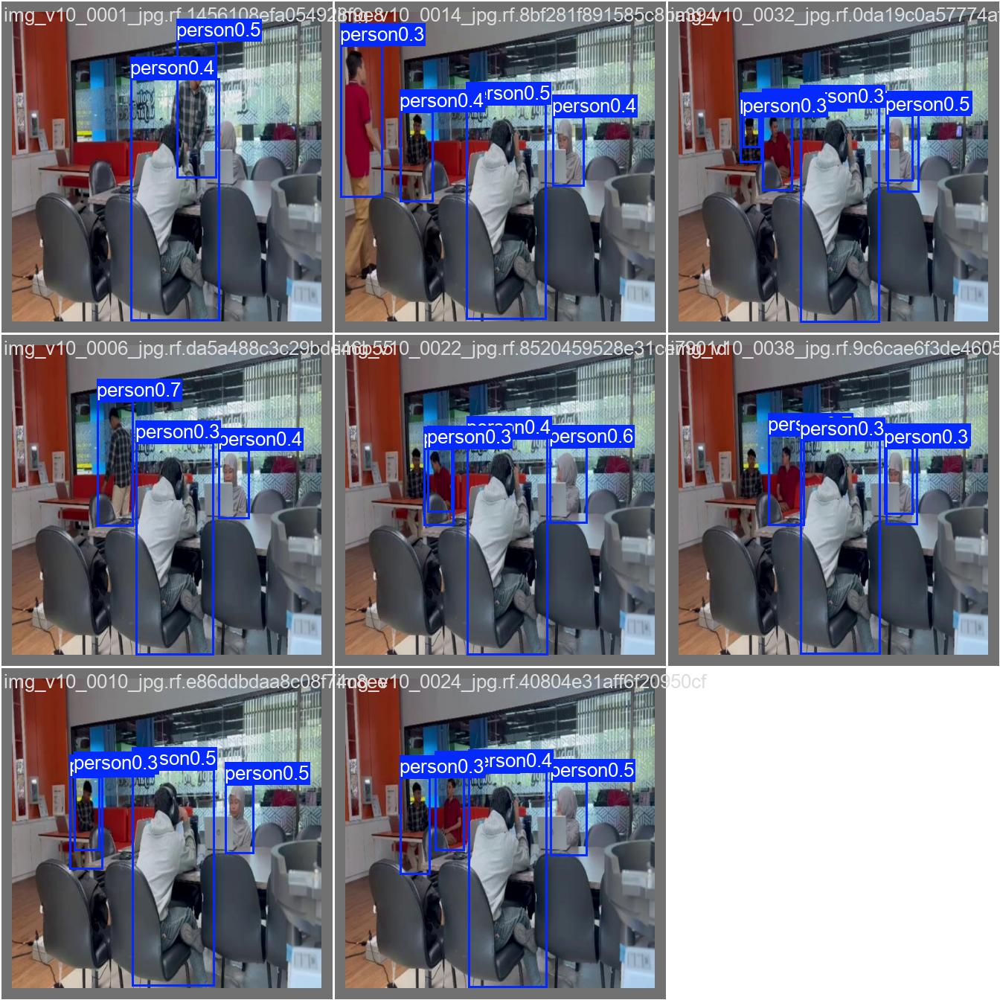
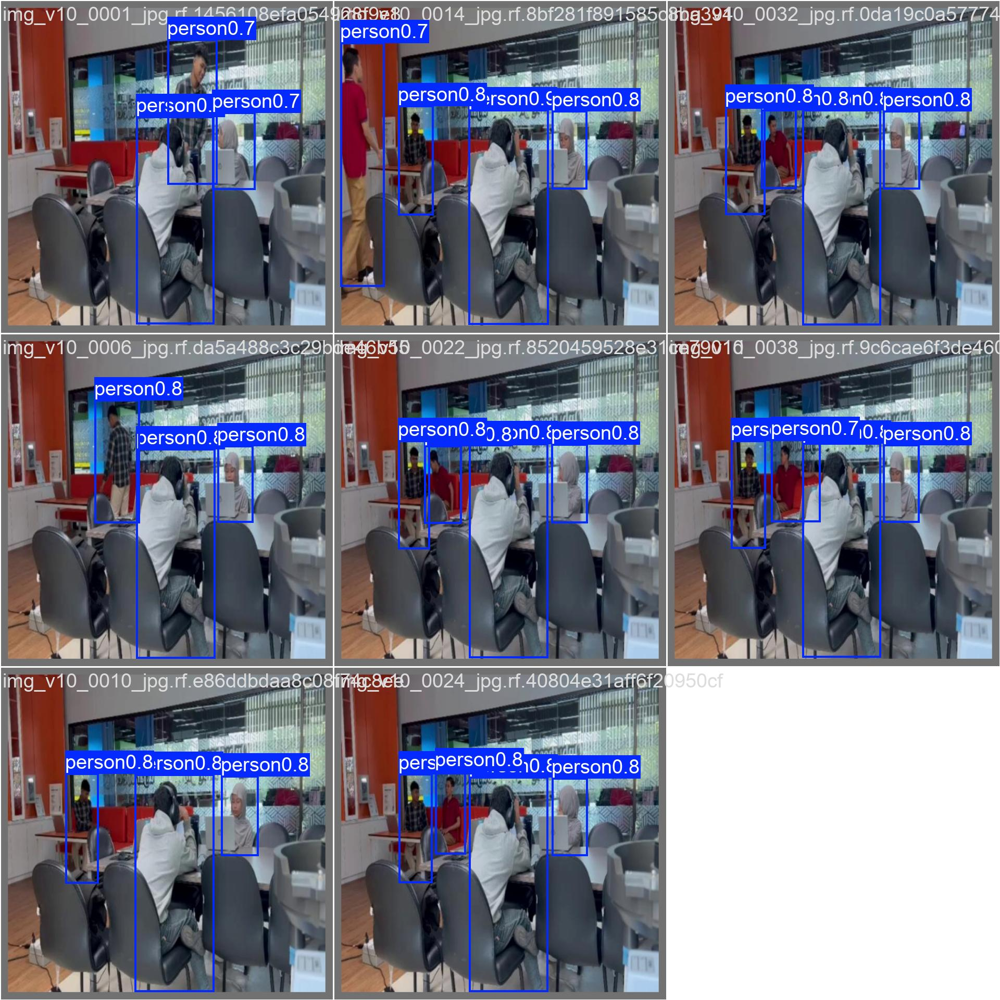

# Praktik Terpadu RET503 — Object Detection YOLO

**Nama:** STIVEN RAIN HEART  
**NIM:** 4222401048  
**Proyek:** Deteksi objek person pada dataset SANINDO

## 1. Deskripsi Proyek

Proyek ini membandingkan tiga eksperimen model YOLO untuk mendeteksi objek `person` menggunakan dataset SANINDO. Evaluasi dilakukan dengan metrik Precision, Recall, mAP50, dan mAP50-95.

## 2. Dataset

Dataset: [SANINDO — Roboflow Universe](https://universe.roboflow.com/maikaels-workspace/sanindo)

Kelas yang digunakan:
- `0: person`

Dataset dibagi menjadi data training, validation, dan testing. Folder gambar dan label tidak disertakan dalam repository ini. Unduh dataset dari sumbernya, lalu susun foldernya sesuai struktur yang dijelaskan di bawah.

## 3. Struktur Proyek

```text
YOLO/
├── 00_ambil_subset_coco.py
├── 01_cek_anotasi.py
├── 02_yolo_ke_coco.py
├── 03_coco_ke_yolo.py
├── 05_split_dataset_yolo.py
├── 06_latih_bandingkan.py
├── 07_lanjut_E2_E3.py
├── 07_siapkan_sanindo.py
├── dataset_sanindo_v1/
│   └── data.yaml
├── hasil_praktik/
│   ├── E1_pretrained/
│   ├── E2_scratch/
│   ├── E3_tuning/
│   ├── hasil_praktik_4222401048.csv
│   └── hasil_praktik_4222401048.txt
└── README.md
```

## 4. Eksperimen

Semua eksperimen menggunakan 10 epoch dan batch size 4.

| Eksperimen | Konfigurasi | mAP50 | mAP50-95 |
|---|---|---:|---:|
| E1 — Pretrained | Bobot pretrained, imgsz 416 | 90.64% | 55.32% |
| E2 — Scratch | Bobot awal acak, imgsz 416 | 66.39% | 31.78% |
| E3 — Tuning | Bobot pretrained, imgsz 640 | 91.42% | 57.30% |

E3 memperoleh mAP50-95 validasi tertinggi, yaitu 57.30%.

## 5. Hasil Evaluasi Test

Model yang dipilih berdasarkan hasil validasi adalah E3 — Tuning.

| Metrik | Hasil |
|---|---:|
| Precision | 89.02% |
| Recall | 84.51% |
| mAP50 | 92.38% |
| mAP50-95 | 56.08% |

Hasil evaluasi disimpan dalam laporan TXT dan CSV di folder `hasil_praktik/`.

## 6. Lingkungan

- Sistem operasi: Windows
- Python: 3.14.5
- Ultralytics: 8.4.182
- PyTorch: 2.14.1+cu130
- GPU: NVIDIA GeForce RTX 3050 Laptop GPU

Versi perangkat lunak dan ketersediaan CUDA dapat berbeda pada komputer lain.

## 7. Instalasi dan Penggunaan

1. Instal Python dan Git.
2. Unduh atau clone repository.
3. Buat virtual environment.
4. Instal Ultralytics dan dependensi PyTorch yang sesuai dengan perangkat.
5. Unduh dataset SANINDO dan susun folder `images/` serta `labels/` menjadi `train/`, `val/`, dan `test/` di dalam `dataset_sanindo_v1/`.
6. Jalankan perintah dari direktori utama proyek.

Untuk menjalankan eksperimen perbandingan utama:

```powershell
python 06_latih_bandingkan.py --nim 4222401048 --nama "STIVEN RAIN HEART" --data .\dataset_sanindo_v1\data.yaml --model yolo26n --epochs 10 --batch 4 --device 0
```

Script utama menjalankan E1, E2, dan E3 berurutan. Untuk menjalankan script lanjutan yang memakai E1 yang sudah tersimpan dan melatih E2 serta E3, gunakan:

```powershell
python 07_lanjut_E2_E3.py
```

Pastikan dataset dan bobot E1 tersedia sesuai lokasi yang diharapkan sebelum menjalankan script lanjutan.

## 8. Catatan

- Folder virtual environment, dataset gambar/label, cache, serta bobot `.pt` dikecualikan dari Git untuk menjaga repository tetap ringan.
- Grafik, hasil eksperimen, konfigurasi dataset, dan laporan praktikum disertakan sebagai dokumentasi hasil.
- Metrik yang dicantumkan adalah hasil dari eksperimen pada dataset dan konfigurasi tersebut.

## 9. Sumber Dataset

SANINDO — Roboflow Universe:  
https://universe.roboflow.com/maikaels-workspace/sanindo

## 10. Visualisasi Hasil Eksperimen

Bagian ini menampilkan grafik hasil training, confusion matrix, kurva Precision-Recall, dan contoh prediksi dari setiap eksperimen.

### 10.1 Grafik Training

| E1 — Pretrained | E2 — Scratch | E3 — Tuning |
|---|---|---|
|  |  |  |

### 10.2 Confusion Matrix

| E1 — Pretrained | E2 — Scratch | E3 — Tuning |
|---|---|---|
|  |  |  |

### 10.3 Kurva Precision-Recall

| E1 — Pretrained | E2 — Scratch | E3 — Tuning |
|---|---|---|
|  |  |  |

### 10.4 Contoh Prediksi pada Data Validasi

| E1 — Pretrained | E2 — Scratch | E3 — Tuning |
|---|---|---|
|  |  |  |

Gambar di atas digunakan untuk membandingkan visualisasi dan hasil prediksi antareksperimen. Hasil kuantitatif tetap mengacu pada metrik validasi dan evaluasi test yang tercantum sebelumnya.
